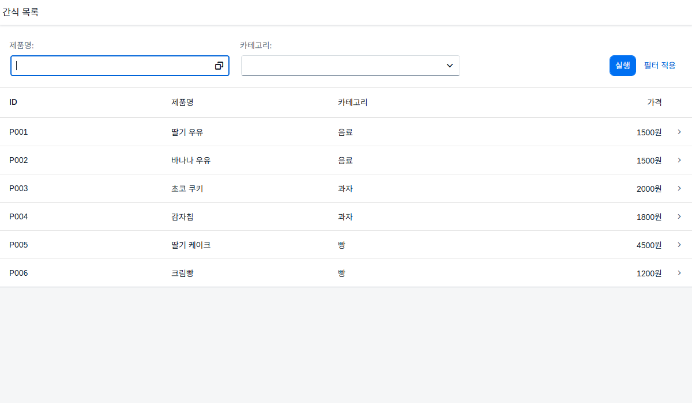
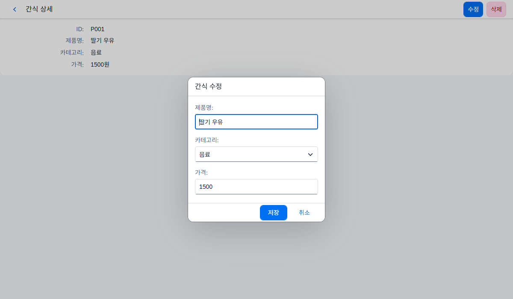

# UI5 앱: 간식 가게

SAPUI5로 만든 작은 연습용 앱입니다. SAP 서버 없이 JSON 더미 데이터로 동작하고, 실제 OData 서버가 생기면 주석만 바꿔서 연결할 수 있게 짜 두었습니다.

**데모: https://moonbyoungyoon.github.io/beginning-ui5-app/** (설치 없이 브라우저에서 바로 실행)




## 요구사항별 위치

| 요구사항 | 구현 위치 |
|---|---|
| 1. UI5 앱 | SAPUI5 1.136 (LTS) + UI5 Tooling |
| 2. `sap.m.App` + Page(헤더/본문) | `view/App.view.xml`, `view/List.view.xml`, `view/Detail.view.xml` |
| 3. JSON 더미 데이터 + OData 전환용 주석 | `controller/*.controller.js` 의 `[현재]` / `[OData]` 블록 |
| 4-1. 페이지 이동 | `manifest.json` 의 `routing`, `List.controller.js > onItemPress`, `Detail.controller.js > onNavBack` |
| 4-2. 프래그먼트 팝업 | `view/fragment/EditDialog.fragment.xml`, `Detail.controller.js > onEdit` |
| 4-3. 스마트필터 검색 + 테이블 | `List.view.xml` 의 `SmartFilterBar` + `Table`, `List.controller.js > onSearch` |
| 4-4. 수정 / 삭제 | `Detail.controller.js > onSaveEdit`, `onDelete` |

## 실행 방법

Node.js 20 이상이 설치된 PC에서:

```bash
npm install      # UI5 Tooling 설치 (처음 한 번)
npm start        # http://localhost:8081/index.html 이 브라우저에 열림
```

- 검색: 제품명에 `*딸기*` 처럼 별표를 붙이면 "포함" 검색, `딸기` 만 쓰면 "정확히 일치" 검색입니다.
- 행 클릭 → 상세 페이지, 상세 페이지의 [수정] → 팝업, [삭제] → 확인 후 삭제.
- 더미 데이터라서 새로고침하면 원래 데이터로 돌아옵니다.

## 폴더 구조

```
webapp/
├─ index.html                  시작 페이지 (UI5 로드 후 앱 시작)
├─ manifest.json               앱 설정: 데이터소스, 모델, 페이지 이동 규칙
├─ Component.js                앱 본체: 가짜 OData 서버 시작, 라우터 시작
├─ view/
│  ├─ App.view.xml             sap.m.App (페이지를 담는 그릇)
│  ├─ List.view.xml            목록: SmartFilterBar + Table
│  ├─ Detail.view.xml          상세: 헤더에 수정/삭제 버튼
│  └─ fragment/EditDialog.fragment.xml   수정 팝업
├─ controller/
│  ├─ List.controller.js       데이터 로드, 검색, 행 클릭
│  └─ Detail.controller.js     상세 표시, 수정, 삭제
└─ localService/               SAP 서버 대역
   ├─ metadata.xml             OData 서비스 설명서 (SmartFilterBar가 읽음)
   └─ mockdata/*.json          더미 데이터
```

## 왜 MockServer가 있나

`SmartFilterBar`는 OData `$metadata`(서비스 설명서)를 읽어서 검색 필드를 자동으로 만드는 부품이라, JSON 모델만으로는 동작하지 않습니다. 그래서 `Component.js` 에서 MockServer로 브라우저 안에 가짜 OData 서비스를 띄웁니다. 화면 데이터는 요구사항대로 JSON 모델(`product`)에 들어갑니다.

## 실제 SAP(OData) 서버로 바꿀 때

1. `manifest.json > dataSources.mainService.uri` 를 실제 서비스 주소로 바꿉니다.
2. `Component.js` 의 `[현재] 가짜 OData 서버` 블록을 지웁니다.
3. 컨트롤러의 `[현재]` 블록을 지우고 `[OData]` 블록 주석을 풉니다.

| 파일 | 함수 | OData 호출 | HTTP |
|---|---|---|---|
| `List.controller.js` | `onInit` | `read("/Products")`, `read("/Categories")` | GET |
| `List.controller.js` | `onSearch` | `read("/Products", { filters })` | GET `?$filter=` |
| `Detail.controller.js` | `onSaveEdit` | `update("/Products('P001')", data)` | PUT |
| `Detail.controller.js` | `onDelete` | `remove("/Products('P001')")` | DELETE |

OData 호출이 성공하면 `[현재]` 와 같은 `fnApply` 로 화면용 JSON 모델을 갱신하므로, 뷰(XML)는 바꿀 필요가 없습니다.

## 데모 사이트 배포 (GitHub Pages)

`main` 브랜치에 push하면 `.github/workflows/deploy.yml` 이 `ui5 build` 후 UI5 경로를 SAP 공식 CDN으로 바꿔서 GitHub Pages에 배포합니다.
